<div align="center">

<picture>
  <source media="(prefers-color-scheme: dark)" srcset="assets/branding/banner.gif">
  <source media="(prefers-color-scheme: light)" srcset="assets/branding/banner-light.gif">
  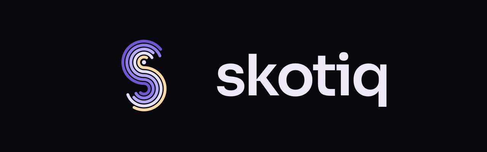
</picture>

# Skotiq

**Astrophotography capture software that runs the whole night from one app.**

[](https://github.com/Scdouglas1999/Skotiq/releases/latest)
[](#downloads)
[](#running-it-from-somewhere-else)
[](LICENSE)

[**Download 8.0.0**](https://github.com/Scdouglas1999/Skotiq/releases/latest) · [Documentation](docs/index.md) · [Release notes](docs/release/v8.0.0.md) · [Known limitations](docs/known-limitations.md) · [Patreon](https://www.patreon.com/cw/SeanDouglas)

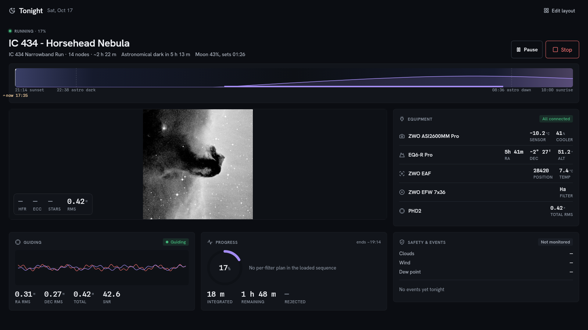

<sub>Tonight, on a real imaging laptop the morning after a night's imaging: the target, the plan with its clock times, the gear's live state, and the checklist before you start — one screen.</sub>

</div>

---

Plan your targets, connect your equipment, frame the field and run the night from one
workspace. Skotiq brings sequencing, autofocus, guiding, weather monitoring and
post-session processing together around a shared equipment profile and session.

A Rust core handles device control and image processing, with a Flutter desktop
interface and remote access from a second computer or Android companion. A headless
host can keep the observatory running while clients connect and disconnect.

> [!NOTE]
> Skotiq is the renamed Nightshade. Existing installs migrate settings, equipment
> profiles, sequences, targets, and history on first run — see
> [the rename note](docs/release/rebrand-skotiq.md). On Android it's a fresh install
> (`com.skotiq.mobile`) that re-pairs in a minute.

## A night, start to finish

<table>
<tr>
<td width="50%" valign="top">
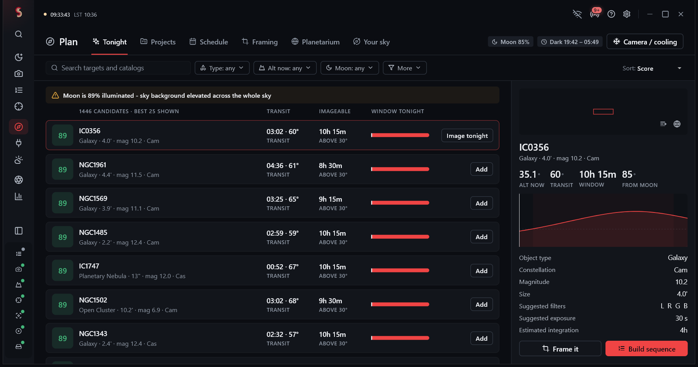
<p><b>Work out what to shoot.</b> Everything in the catalog, scored for tonight against
how high it gets, when it transits, how long it stays up, where the Moon is and what your
horizon blocks. Click one and you get its altitude curve and a suggested exposure.</p>
</td>
<td width="50%" valign="top">
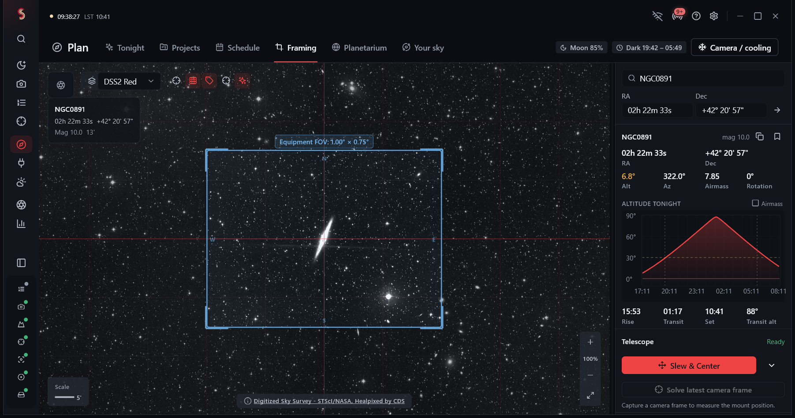
<p><b>Frame it before you waste the clear sky.</b> Your actual sensor and focal length
over real survey imagery, so you can see whether it fits and which way to rotate.
Mosaic panels get laid out here too.</p>
</td>
</tr>
<tr>
<td valign="top">
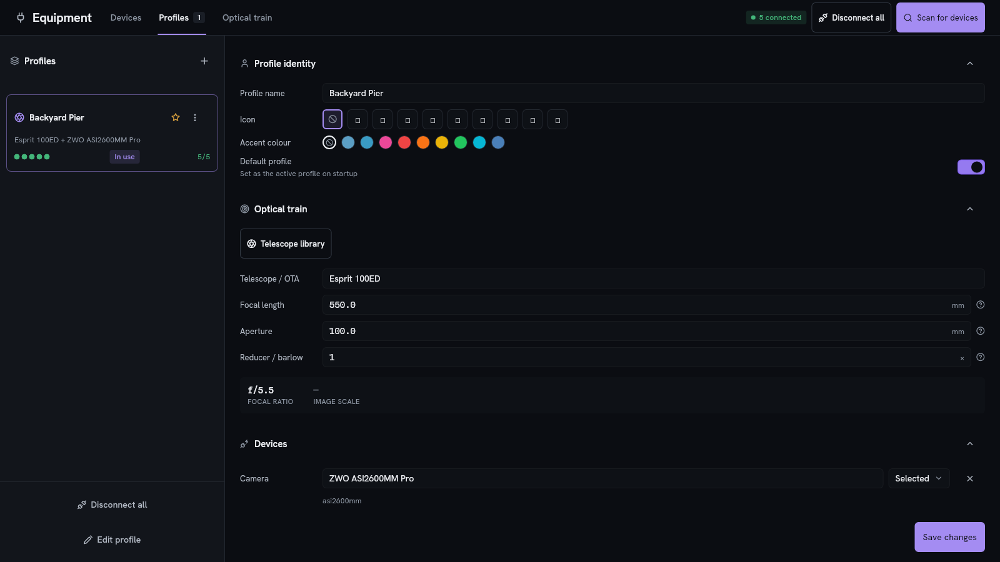
<p><b>Connect once.</b> Save the rig as a profile — camera, mount, focuser, filter wheel,
guider and the optics in front of them — and it brings the lot back next time.</p>
</td>
<td valign="top">
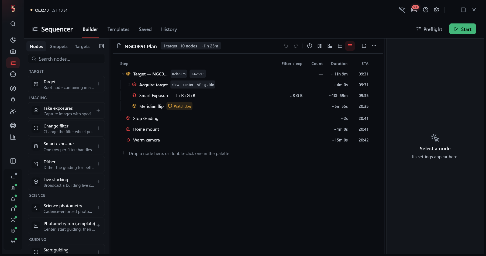
<p><b>Build the run.</b> Steps you drag together: cool the camera, autofocus, loop through
filters, dither, flip, park. A twelve-hour run reads as a table with counts and finish
times rather than a tree you scroll through.</p>
</td>
</tr>
<tr>
<td valign="top">
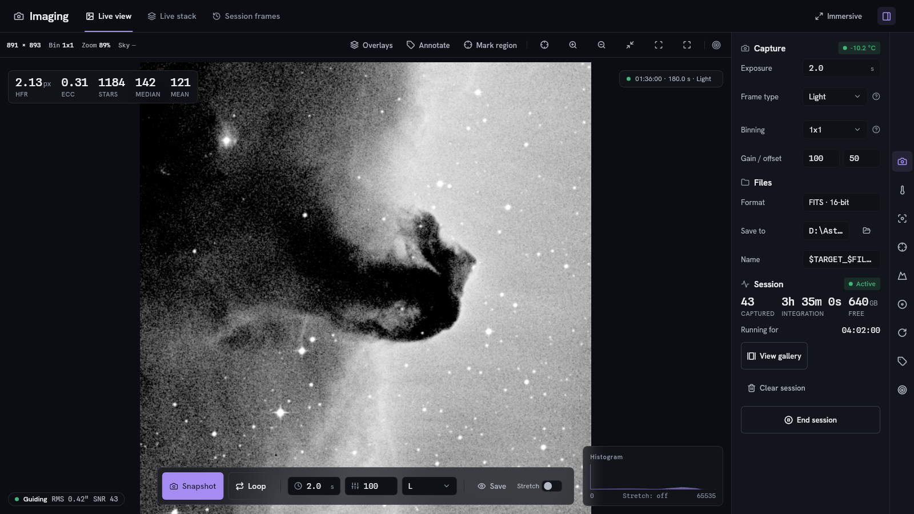
<p><b>Watch the frames come in.</b> Star count, HFR and eccentricity measured off each
frame as it lands, so you find out focus has drifted before you've lost an hour to it.</p>
</td>
<td valign="top">
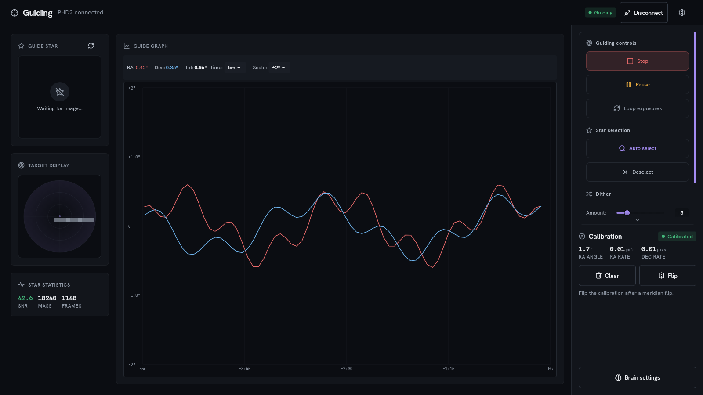
<p><b>Guide without alt-tabbing.</b> Drive PHD2 from here, or use the built-in multi-star
guider. Capture waits for the dither to settle either way.</p>
</td>
</tr>
<tr>
<td valign="top">
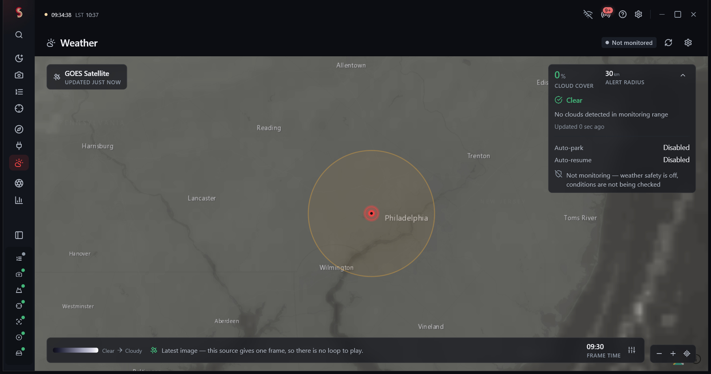
<p><b>See the clouds coming.</b> Live satellite imagery over your site, with an alert
radius you set. Weather, your safety monitor, twilight and free disk space all feed one
answer about whether it's safe to carry on.</p>
</td>
<td valign="top">
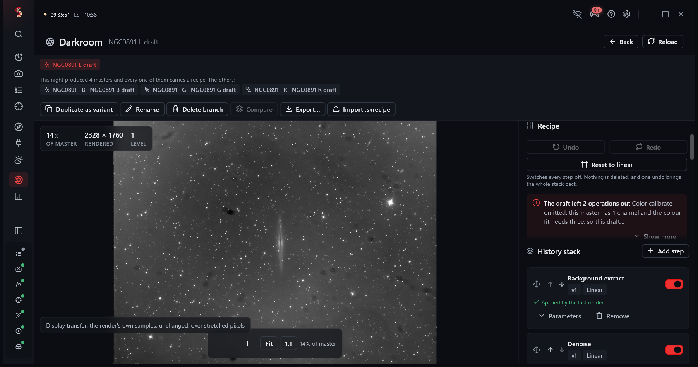
<p><b>Process what you shot.</b> The Darkroom stacks each filter's frames into masters
and drafts the color composite for you at dawn — the NGC 891 master above came out of
the nights pictured throughout this page.</p>
</td>
</tr>
<tr>
<td colspan="2" valign="top">
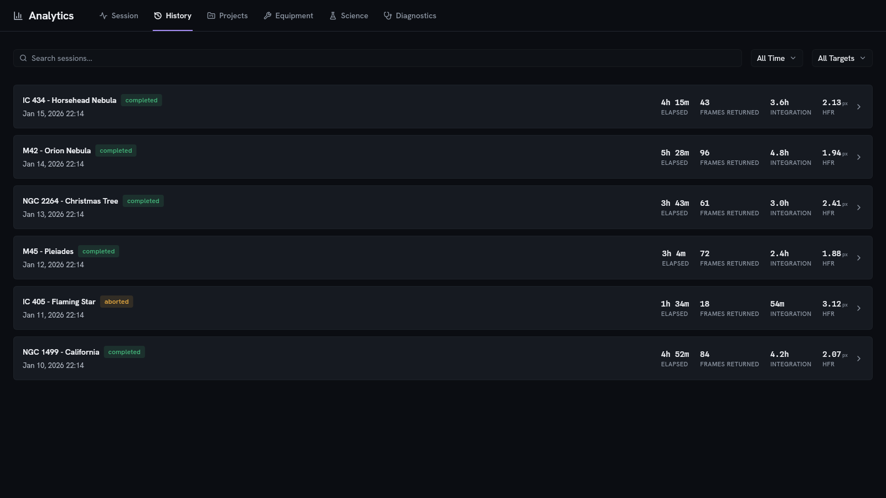
<p><b>Look back at it.</b> Every session with its frame count, integration time and
median HFR, the guiding history, and what the automation decided and why. Frames get
labeled, never deleted or thrown out for you.</p>
</td>
</tr>
</table>

## What else is in there

Sequences are built from steps, and the steps cover the awkward parts: retries, meridian
flips, dithering, V-curve autofocus, calibration frames, and conditions and loops around
any of it. If the machine restarts mid-run, the sequence can pick up where it left off.

When the app doesn't know whether it's safe — no weather data, a sensor that's gone
quiet — it treats that as *not safe* rather than assuming things are fine. Bad weather,
a full disk, or an emergency stop can hold the run and send the mount to park with the
dome and cover shut.

Automated decisions get written down as they happen, so when something goes wrong at 2am
you can read back what the app thought it was doing instead of guessing.

There's a fair amount beyond plain capture, too:

- **Tonight** is the night-control room: the target, the plan with clock times, the
  frame stage, charts for guiding and focus, the night's log, the devices, the
  conditions, and the recovery state — one screen, not six panels.
- **Your Sky** builds a personal atlas out of your own plate-solved frames, filling in
  as you shoot more.
- **First Light** goes through transient candidates and cross-matches them. It can
  submit to TNS directly; AAVSO and MPC come out as files you send yourself.
- **Constellation** and **Collaborative Sky** handle shared calibration libraries,
  mosaic panels a group can split between them, and live shared sessions. They only
  work against a server you or your club runs — there's no public Skotiq server and no
  default address.
- **Science tools** for photometric calibration against catalog references, period
  analysis, and report exports.
- **Backup** to a local folder, WebDAV, or S3-compatible storage (AWS, MinIO,
  Backblaze), with credentials kept in your operating system's keyring.

## Running it from somewhere else

You can run Skotiq as a normal desktop app, or leave it running on the computer at the
telescope and connect from elsewhere. The machine with the hardware stays in charge
either way.

| | Good for | What you get |
|---|---|---|
| **Desktop app** | Setting up, planning, imaging, going through results | Everything |
| **A second PC** | A proper remote control room | The full desktop app linked to the host's live session over the network — same screens, same frames, same run |
| **Headless host** | An observatory PC you don't sit at | The same program with `--headless`, plus a password-protected API and a browser dashboard at `/dashboard` |
| **Android app** | Checking from bed, or stopping something | Pairing, monitoring, and camera, mount and sequencer control |

A few things worth knowing before you put a host on a network:

- It only listens on the local machine (port 8080) until you set up a password.
  Putting it on the network without one takes a deliberate command-line flag.
- With no password set, anything that matters returns "not authorized". Only pairing
  and the dashboard page stay reachable, so a fresh machine can still be set up.
- Access tokens can be view-only, control or admin, or limited to particular things.
- Push notifications work over your own network out of the box. Push from outside your
  network is written but does nothing until you supply your own Firebase or Apple
  credentials.

Read the [secure setup guide](docs/headless-secure-setup.md) before exposing a host to
a network you don't control, and the [firewall notes](docs/troubleshooting/firewall.md)
if a second device can't find it.

## Hardware

Skotiq talks to gear four ways. A yes means Skotiq can look for and connect to
devices that way on that platform — what any individual driver can actually do is up
to the driver, and it tells you once it connects.

| | Windows | Linux | macOS | Notes |
|---|:---:|:---:|:---:|---|
| **ASCOM COM** | Yes | — | — | Needs the ASCOM Platform and your device drivers installed |
| **ASCOM Alpaca** | Yes | Yes | Yes | Network devices and bridges |
| **INDI** | Yes | Yes | Yes | Needs an INDI server it can reach; how much works varies by driver |
| **Native SDK** | If installed | If installed | If installed | Only works once you've installed the manufacturer's own library and driver |

This is the same table the app shows under Settings → Connection. If they ever
disagree, that's a bug worth reporting.

There are native camera drivers for **ZWO ASI, QHY, Player One, SVBony, Atik, FLI,
Moravian and the Touptek family**, and native mount support for **SkyWatcher/Synta,
iOptron and LX200-style serial mounts** (Meade, OnStep, Losmandy, 10Micron). The
downloads here contain none of the manufacturers' own libraries — those paths only
light up once you've installed the vendor's driver yourself.

**Plate solving needs ASTAP or astrometry.net.** Install one and point Skotiq at it;
there's no solver built in.

**Guiding** works through PHD2, or with Skotiq's own multi-star guider.

Have a look at the [hardware list](docs/supported-hardware-by-platform.md) before
building a profile.

## Downloads

| File | Platform | Notes |
|---|---|---|
| `skotiq-8.0.0-windows-x64.zip` | Windows x64 | Portable — extract and run. Not code-signed yet |
| `skotiq-8.0.0-linux-x64.tar.gz` | Linux x64 | Portable bundle, needs glibc 2.35 or newer |
| `skotiq-8.0.0-android-arm64-v8a.apk` | Android | The companion app. Also built for `armeabi-v7a` and `x86_64` |

**There's no macOS or iOS build.** The Mac version compiles, but nothing is packaged
and neither has ever been run against hardware. Treat them as source only.

Every file comes with a `.sha256` so you can check it downloaded intact. The desktop
archives also contain the license, the third-party notices, and a note of the exact
commit they were built from.

Desktop and Android updates use signed manifests verified against the key embedded
in the app. Windows executables are not code-signed, so Windows may display a
SmartScreen warning. Back up your settings and database before upgrading.

**What you need to run it.** On Windows: Windows 10 or 11 (64-bit), 8 GB of RAM
(16 GB is better), a reasonably modern GPU, and the ASCOM Platform if you use ASCOM
drivers. On Linux: 64-bit with glibc 2.35 or newer, an OpenGL 3.3 GPU, and GTK 3,
libsecret, libusb, libudev and OpenSSL. USB gear also needs the manufacturer's udev
rules and the right group membership. Allow about 500 MB for the app, plus room for
your catalogs and frames.

## Getting started

1. Download the file for your platform from
   [Releases](https://github.com/Scdouglas1999/Skotiq/releases/latest), and check the
   `.sha256` checksum.
2. Extract the whole thing somewhere you can write to. Don't run it from inside the
   zip.
3. Start it — `skotiq.exe` on Windows, `./skotiq` on Linux. Windows may warn about an
   unsigned program; verify the download before running it.
4. **Download the sky catalogs on first run.** They aren't bundled, because they're
   large. Settings → Catalogs → Download catalogs fetches the star and deep-sky
   catalogs, about 60 MB. Until you do, the planetarium only has a handful of bright
   stars and the planner has nothing to score.
5. Install whatever your rig needs that Skotiq can't ship: the ASCOM Platform and your
   drivers on Windows, an INDI server on Linux, PHD2 if you guide with it, and ASTAP
   or astrometry.net for plate solving.
6. Connect your first device and save an equipment profile.

Longer versions: [installation](docs/getting-started/installation.md) →
[first connection](docs/getting-started/first-connection.md) →
[first image](docs/getting-started/first-image.md).

To run it as an observatory machine instead:

```
skotiq --headless --require-auth
```

## Tested under the night sky

The imaging workflow has completed **two nights on real hardware** during development
in October 2026: a Pegasus NYX-101 mount, ZWO ASI1600MM-Cool camera, ZWO EAF focuser,
eight-slot filter wheel and PHD2 guiding on Windows. The screenshots above were
captured from that laptop's running session, including its session history and an
L-filter master of NGC 891 in the Darkroom.

See [compatibility and known limitations](docs/known-limitations.md) for hardware
coverage, platform availability and remaining limitations. Subsequent integration
changes are validated separately by automated checks.

## Building it yourself

It's a Flutter workspace over a Rust core, joined with `flutter_rust_bridge` and
managed with Melos. Use the scripts — they keep the generated code and the native
libraries in step.

```bash
dart pub global activate melos
melos bootstrap
./scripts/dev.sh          # Linux and macOS
```

On Windows that's `melos run dev` instead.

| Command | What it does |
|---|---|
| `./scripts/dev.sh` / `melos run dev` | Regenerate the bridge, build Rust, launch the desktop app |
| `./scripts/dev.sh --skip-frb` / `melos run dev:quick` | The same, without regenerating the bridge |
| `melos run generate` | Regenerate the database, model and bridge code |
| `melos run test` | Run the tests |
| `melos run analyze` | Static analysis |
| `melos run build:desktop:linux` | Build the Linux release |
| `melos run build:desktop:windows` | Build the Windows release |

CI uses Flutter 3.44.1 and stable Rust. Platform prerequisites, and what to do when
the bridge misbehaves, are in the [developer docs](docs/index.md) and the
[bridge guide](docs/FRB_TROUBLESHOOTING.md).

## Documentation

| Getting going | Using it | How it works |
|---|---|---|
| [Installation](docs/getting-started/installation.md) | [Supported hardware](docs/supported-hardware-by-platform.md) | [Architecture](docs/architecture.md) |
| [First connection](docs/getting-started/first-connection.md) | [Known limitations](docs/known-limitations.md) | [Plugin SDK](docs/plugin_sdk/README.md) |
| [First image](docs/getting-started/first-image.md) | [Securing a headless host](docs/headless-secure-setup.md) | [HTTP API](docs/api/README.md) |
| [8.0.0 release notes](docs/release/v8.0.0.md) | [Backup and moving machines](docs/migration-backup-restore.md) | [Contributing](.github/CONTRIBUTING.md) |
| [The rename](docs/release/rebrand-skotiq.md) | [Remote control](docs/remote-control.md) | [Changelog](docs/CHANGELOG.md) |

The [Plugin SDK](docs/plugin_sdk/README.md) covers plugins built into the app, with
working examples in `packages/skotiq_plugins`. Dropping a third-party plugin binary
into a released build isn't supported.

## Support and contribute

Skotiq is free to use. [Support development on Patreon](https://www.patreon.com/cw/SeanDouglas)
to help fund hardware testing, compatibility work and continued development.

[Report a bug](https://github.com/Scdouglas1999/Skotiq/issues) with your operating
system, equipment and driver versions, reproduction steps and relevant logs.
See [Contributing](.github/CONTRIBUTING.md) for development guidance and
[Security](.github/SECURITY.md) for private vulnerability reports.

## License

Skotiq is source-available, which isn't the same as open source. You can read, build
and audit it under the terms in [LICENSE](LICENSE). Please read those terms before
redistributing it or building something on top of it.

---

<div align="center">

[Download](https://github.com/Scdouglas1999/Skotiq/releases/latest) · [Docs](docs/index.md) · [Issues](https://github.com/Scdouglas1999/Skotiq/issues) · [Patreon](https://www.patreon.com/cw/SeanDouglas)

</div>
